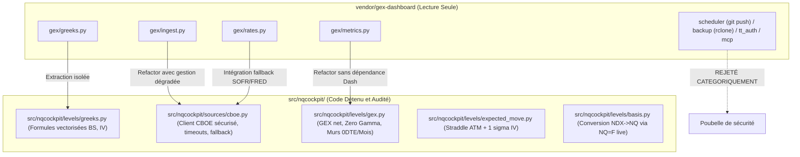

# Rapport d'Audit de Sécurité et Méthodologie du Code Tiers (`vendor/`)

**Date de l'audit** : 2026-09-29  
**Type d'analyse** : Audit statique approfondi en lecture seule (aucun code tiers exécuté, aucun paquet importé)  
**Périmètre audité** :
- `vendor/gex-dashboard`
- `vendor/gammagrid`
- `vendor/gex-analytics`

---

## 1. Synthèse Exécutive et Verdicts

| Dépôt | Licence | Dernière Activité (`.git/logs/HEAD`) | Verdict | Recommandation d'Intégration |
| :--- | :--- | :--- | :---: | :--- |
| **`vendor/gex-dashboard`** | **MIT** (2026 Darthreign) | 2026-09-28 20:02:37 EDT (date du clone local, activité upstream non vérifiée) | **À ADAPTER** | **Cœur mathématique retenu.** Adapter `greeks.py`, `ingest.py`, `metrics.py`, `rates.py` dans `src/nqcockpit/`. Écarter impérativement `scheduler.py` (git push auto), `backup.py` (rclone), `tt_auth.py` / `rtquote.py` (Tastytrade/registre Windows) et `mcp_server.py`. |
| **`vendor/gammagrid`** | **AGPLv3** (2024-2026 Gammagrid) | 2026-09-28 20:02:40 EDT (date du clone local, activité upstream non vérifiée) | **À ÉVITER** | **Contamination juridique virale.** Licence AGPLv3 incompatible avec une intégration propre. Dépendance lourde à Docker, PostgreSQL et Streamlit. Ne copier aucun code dans `src/`. |
| **`vendor/gex-analytics`** | **MIT** (2024 pikki622) | 2026-09-28 20:02:43 EDT (date du clone local, activité upstream non vérifiée) | **À ÉCARTER** | **Code trop fragile.** Concaténation naïve des calls/puts par simple `axis=1` sans jointure par strike (crash au moindre strike manquant). Aucun test unitaire, aucun apport technique par rapport à `gex-dashboard`. |

---

## 2. Inventaire Exhaustif des Risques de Sécurité (Fichier:Ligne)

### 2.1 Exécution de Commandes et Sous-processus (`subprocess`, `os.system`, `eval`, `exec`, `pickle`)

> [!CAUTION]
> **Danger critique identifié dans `gex-dashboard`** : le planificateur automatique lance des commandes Git distantes (`git push`) et invoque `rclone` sans validation de destination.

- **`vendor/gex-dashboard/gex/scheduler.py:178-187`** : Exécute des commandes Git automatiques sur le système hôte :
  ```python
  subprocess.run(["git", "-C", str(repo), "add", "-A"], check=True, capture_output=True)
  diff = subprocess.run(["git", "-C", str(repo), "diff", "--cached", "--quiet"])
  subprocess.run(["git", "-C", str(repo), "commit", "-m", f"data {day}"])
  subprocess.run(["git", "-C", str(repo), "push"], check=True)  # <-- PUSH DISTANT AUTOMATIQUE
  ```
  *Risque* : Exfiltration involontaire de données ou de secrets si un remote Git est configuré. **Cette logique ne doit JAMAIS être importée ni exécutée dans NQ Cockpit.**
- **`vendor/gex-dashboard/gex/backup.py:54, 99`** : Invoque l'exécutable externe `rclone` via `subprocess.run([exe, "listremotes"])` et exécute un sync cloud distant.
- **`vendor/gex-dashboard/gex/lockdiag.py:104-105`** : Invoque `subprocess.run` pour analyser les verrous de fichiers sous Windows.
- **`os.system`, `os.popen`, `eval`, `exec`, `pickle`** : **0 occurrence** dans l'ensemble des trois dépôts. Aucun déchiffrement dynamique suspect ni désérialisation non sécurisée détectée.

---

### 2.2 Appels Réseau Sortants & Endpoints Externes

| Dépôt | Fichier:Ligne | Endpoint Contacté | Usage & Risque |
| :--- | :--- | :--- | :--- |
| `gex-dashboard` | `gex/ingest.py:25` | `https://cdn.cboe.com/api/global/delayed_quotes/options/{sym}.json` | **CBOE options (gratuit)** : endpoint CDN non documenté officiellement mais public et gratuit. Délai 15 min. |
| `gex-dashboard` | `gex/rates.py:34` | `https://markets.newyorkfed.org/api/rates/secured/sofr/last/1.json` | **NY Fed SOFR (gratuit)** : taux sans risque au jour le jour officiel de la Fed de New York. |
| `gex-dashboard` | `gex/backfill.py:178` | `https://cdn.cboe.com/api/global/us_indices/daily_prices/SPX_History.csv` | Téléchargement d'historique CBOE. |
| `gex-dashboard` | `gex/backfill.py:180` | `https://fred.stlouisfed.org/graph/fredgraph.csv?id=NASDAQ100` | Téléchargement CSV historique FRED. |
| `gex-dashboard` | `gex/tt_auth.py:24-25` | `https://my.tastytrade.com/auth.html`, `https://api.tastyworks.com/oauth/token` | **Tastytrade OAuth** (courtier payant, flux propriétaire). |
| `gex-dashboard` | `gex/rtquote.py:35-37` | `https://api.tastyworks.com/oauth/token`, `https://api.tastyworks.com/api-quote-tokens` | Flux dxLink temps réel Tastytrade. |
| `gex-dashboard` | `gex/futopt.py:46-47` | `https://api.tastyworks.com/instruments/futures`, `/futures-option-chains/{code}` | Chaînes d'options sur futures Tastytrade. |
| `gex-dashboard` | `gex/flowtape.py:94` | `https://api.tastyworks.com/option-chains/{symbol}/nested` | Carnet et chaînes imbriquées Tastytrade. |
| `gex-dashboard` | `discord_bot/bot.py:46` | API Discord | Bot de diffusion Discord. |
| `gammagrid` | `app/catalogue.py:52` | `https://www.cboe.com/us/options/symboldir/equity_index_options/?download=csv` | Annuaire officiel des symboles CBOE. |
| `gammagrid` | `app/dashboard.py:418, 427`| `https://www.tradingview.com`, `https://s3.tradingview.com/...` | Widgets graphiques tiers TradingView embarqués. |
| `gex-analytics` | `gammaProfileCommandLine.py:33` | `https://cdn.cboe.com/api/global/delayed_quotes/options/_{index}.json` | Scraping direct CBOE options. |

---

### 2.3 Accès Hors Projet & Chemins Absolus

- **`vendor/gex-dashboard/discord_bot/bot.py:145`** : Chemin absolu hardcodé `D:\Gex\data`.
- **`vendor/gex-dashboard/.claude/skills/premarket-nq/SKILL.md:69-71, 90, 95, 124, 138, 170, 202, 239`** : Nombreux chemins absolus hardcodés vers la machine de l'auteur original :
  - `D:\Gex\logs\premarket-nq.log`
  - `D:\Gex\data\prices\<cle>\<jour>.parquet`
  - `D:\Outils de backtest\data\econ_calendar.json`
  - `D:\Gex\data\ticks\NQ\<jour>.parquet`
  - `D:\Gex\data\briefs\matin.md`, `prebrief.md`, `ajustement.md`, `ajustement2.md`
- **Isolation dans `src/`** : Aucun de ces chemins ne sera conservé. Le stockage dans `nqcockpit` utilise exclusivement les chemins relatifs configurés dans `config.yaml` (`data/`, `logs/`, `reports/`).

---

### 2.4 Lecture et Écriture de Variables d'Environnement / Secrets

| Variable lue | Fichier:Ligne | Nature & Risque |
| :--- | :--- | :--- |
| `DATABENTO_API_KEY` | `gex/backfill.py:60`, `scripts/nightly_import.py:161` | API payante de données de marché. Non requise par défaut. |
| `TT_REFRESH`, `TT_SECRET`, `TASTYTRADE_CLIENT_ID` | `gex/tt_auth.py:39-41`, `gex/rtquote.py:80-82` | Identifiants courtier. **Attention** : `tt_auth.py:85, 94` tente d'écrire ces valeurs dans le **registre Windows utilisateur** (`HKCU\Environment`). |
| `DISCORD_BOT_TOKEN`, `DISCORD_CHANNEL_ID` | `discord_bot/bot.py:65-66` | Token de bot Discord. |
| `DATABASE_URL` | `gammagrid/app/config.py:15` | URL de connexion PostgreSQL. |

**Confirmation de non-chargement par défaut** :
Dans `gex-dashboard`, la fonction `credentials_present()` (`gex/rtquote.py:93`) teste la présence des clés Tastytrade. En l'absence de ces variables dans l'environnement, le code bascule automatiquement sur les flux gratuits ou s'abstient de toute connexion. De même, `backfill.py` n'est jamais appelé par `app.py`.

---

### 2.5 Détection de Consignes / Prompt Injections pour Agents

> [!WARNING]
> **Détection d'instructions pour agents dans `vendor/gex-dashboard/.claude/`**

Le fichier [`vendor/gex-dashboard/.claude/skills/premarket-nq/SKILL.md`](file:///c:/Users/pccom/Desktop/trading%20asistante/vendor/gex-dashboard/.claude/skills/premarket-nq/SKILL.md) contient des directives complètes destinées à un LLM autonome (Claude Code) :
- *Ligne 8-10* : *"Tu es analyste de marché senior, spécialisé dans le scalping contrarien du Nasdaq-100 (NQ)..."*
- *Ligne 19-20* : *"Ne va pas chercher sur le web..."*
- *Ligne 70-71* : *"Journalise chaque étape en ajoutant une ligne à D:\Gex\logs\premarket-nq.log via Bash..."*
- *Ligne 98-99* : *"Ne bloque JAMAIS sur cet accès. Tu tournes sans personne devant l'écran..."*
- *Ligne 138, 170, 202, 239* : Ordres d'écriture directe dans des dossiers système `D:\Gex\data\briefs\...`.

**Conclusion d'audit** : Ce fichier est une ressource documentaire interne de l'auteur original et ne constitue pas une attaque malveillante, mais il contient des instructions impératives qui ne doivent **en aucun cas** être exécutées ou adoptées par notre cockpit.

---

### 2.6 Fichiers de Configuration MCP et Outils

- **`vendor/gex-dashboard/.mcp.json`** :
  ```json
  {
    "mcpServers": {
      "gex-data": {
        "command": ".venv\\Scripts\\python.exe",
        "args": ["-m", "gex.mcp_server"]
      }
    }
  }
  ```
- **`vendor/gex-dashboard/gex/mcp_server.py`** : Serveur FastMCP (277 lignes) exposant `get_gex_summary`, `get_gex_by_strike`, `get_flow_delta`, `get_history`, `get_market_context`.
- **Verdict** : Conforme aux règles AGENTS.md, **le serveur MCP de vendor/ n'est pas lancé**. NQ Cockpit fonctionnera de manière déterministe via ses propres modules Python dans `src/nqcockpit/`.

---

### 2.7 Dépendances & Vérification de Sécurité

- Aucun package n'est épinglé à une URL arbitraire, un tag Git distant non officiel ou un dépôt privé.
- Dépendances mathématiques standardisées : `numpy>=2.0`, `scipy>=1.14`, `pandas>=2.2`, `pyarrow>=17.0`, `requests>=2.32`.
- `gex-dashboard` borne `mcp>=1.0,<2.0` en raison de la réorganisation de FastMCP dans les versions ultérieures.

---

## 3. Comparaison Méthodologique GEX (`gex-dashboard` vs `gex-methodology`)

| Concept | Formule `gex-methodology` | Implémentation `gex-dashboard` (`gex/metrics.py`) | Conformité & Analyse d'Écart |
| :--- | :--- | :--- | :---: |
| **GEX ($ par 1%)** | $GEX = sign \times \Gamma \times OI \times 100 \times S^2 \times 0.01$ (Calls $+$, Puts $-$) | `sign * g * oi * CONTRACT_MULTIPLIER * s**2 * 0.01` (`metrics.py:67`) | **100 % Conforme** |
| **Zero Gamma** | Recalcul GEX net sur grille de spots $\pm 8\%$, interpolation linéaire du passage par zéro le plus proche | `gamma_profile` sur grille $\pm 8\%$, détection `np.diff(np.sign)`, interpolation linéaire (`metrics.py:243-264`) | **100 % Conforme** |
| **Murs de Gamma** | Call Wall = plus fort GEX call $\ge S$ ; Put Wall = plus fort GEX put $\le S$. 0DTE séparé | `key_levels` : `call_wall` (max au-dessus spot), `put_support` (min sous spot) (`metrics.py:404-443`) | **100 % Conforme** |
| **Stabilisation des Murs** | Murs stables sur la session | `compute_levels` sépare `structural_spot` (clôture veille, fige l'OI) de `live_spot` (positionne le côté) | **Avancée majeure** : évite que les murs ne migrent artificiellement avec le spot live. |
| **Expected Move** | $1\sigma = S \times IV \times \sqrt{\text{jours}/252}$ comparé au straddle ATM du front | `expected_move` : Prix du straddle ATM $C_{ATM} + P_{ATM}$ sur nearest expiry (`metrics.py:362-402`) | **Écart méthodologique** : `gex-methodology` définit $1\sigma = S \times IV \times \sqrt{\text{jours}/252}$ et compare ce move au straddle ATM du front. `gex-dashboard` utilise exclusivement le prix du straddle ATM sans calculer la composante $1\sigma$ IV. Dans `nqcockpit`, la formule $S \times IV \times \sqrt{\text{jours}/252}$ sera la référence principale, affichée avec le straddle ATM en contrôle comparatif. |
| **Conversion NDX $\to$ NQ** | $NQ = NDX + \text{base}$, où $\text{base} = NQ=F - \text{^NDX}$ | `futures_basis` : Déduit de la parité call-put synthétique $F = (C-P)e^{rT} + K$ (`metrics.py:284-327`) | **Décisions arrêtées (P02-fix)** : voir détails ci-dessous (barres 1m alignées, base de clôture hors séance, contrôle croisé parité call-put). |

### 3.1 Décisions de conception pour la Conversion NDX vers NQ (Base NQ)

1. **Validation stricte de la base en séance (09:30 - 16:00 ET)** :
   - La base $NQ=F - \text{^NDX}$ n'est valide **que si** $\text{^NDX}$ est live (séance régulière actions 09:30-16:00 ET) **ET** si les deux valeurs proviennent de **barres 1m rigoureusement alignées par horodatage UTC**.
   - Écart temporel maximal admissible : paramètre de configuration (défaut : 60 secondes).
   - **Interdiction absolue** de calculer la base sur de simples « derniers cours » non synchronisés (qui mélangent des barres d'âges différents).
2. **Hors séance actions (préparation pré-market, soirée, week-end)** :
   - Base de référence = celle de la dernière séance régulière actions (dernière barre 1m $\le$ 16:00:00 ET de chaque série).
   - Statut obligatoirement étiqueté : **`« base de la séance précédente »`** accompagné de son âge horodaté.
3. **Contrôle croisé & alerte de cohérence** :
   - Calcul parallèle de la **base implicite par parité call-put** (méthode `futures_basis` de `gex-dashboard`, réécrite proprement dans `src/nqcockpit/levels/basis.py`), affichée en regard de la base mesurée.
   - Si l'écart entre la base réelle et la base implicite dépasse un seuil paramétrable : statut **`DÉGRADÉ`** et émission d'une alerte visible.
4. **Observation de latence $NQ=F$ sur yfinance** :
   - Le flux $NQ=F$ sur yfinance semble présenter un décalage d'environ 10 minutes.
   - Cette latence ne sera pas supposée a priori mais **mesurée et consignée précisément en séance US réelle lors de P03**, avec horodatages à l'appui.

### 3.2 Décisions de conception pour l'Expected Move

- **Formule de référence** : $1\sigma = S \times IV \times \sqrt{\text{jours}/252}$, calculée avec la racine carrée exacte sur la volatilité implicite ATM et le nombre de jours jusqu'à l'échéance.
- **Contrôle comparatif** : Le prix du straddle ATM du front month ($C_{ATM} + P_{ATM}$, méthode issue de `gex-dashboard`) sera systématiquement calculé et affiché en comparaison directe, pour confronter l'attente statistique théorique du modèle Black-Scholes au coût réel négocié sur le marché des options.


---

## 4. Documentation des Limites Méthodologiques Tiers

1. **Endpoint CBOE non officiel** :
   L'URL `https://cdn.cboe.com/api/global/delayed_quotes/options/_NDX.json` est un flux différé de 15 minutes fourni par le CDN de CBOE. CBOE peut modifier la structure du JSON ou appliquer un blocage géographique sans préavis (d'où l'importance de nos plans B documentés en P01).
2. **Open Interest statique journalier** :
   L'Open Interest n'est consolidé par l'OCC qu'une seule fois par jour ouvré (publié vers 06h00 ET). Tout niveau ou profil de GEX intra-séance est donc une **réévaluation au spot courant d'un positionnement de la veille**, et doit toujours être présenté avec la mention `"OI de la veille"`.
3. **Flux Delta / Order Flow** :
   Le calcul de flux delta (`flowtape.py`) basé sur les variations de volume n'est qu'un **proxy probabiliste** et non du véritable carnet d'ordres signé (*aggressive buy/sell*).
4. **Options sur indices vs options sur futures** :
   Le code CBOE porte sur les options d'indice NDX (style européen, règlement cash, modèle Black-Scholes). Il ne modélise pas directement les options sur futures NQ CME (modèle Black-76).

---

## 5. Feuille de Route d'Intégration dans `src/nqcockpit/` (P03 / P04)



### Modules à adapter dans `src/nqcockpit/` :
1. **`src/nqcockpit/levels/greeks.py`** : Copie et typage strict des fonctions Black-Scholes vectorisées de `gex/greeks.py` (sans dividende pour 0DTE, IV solver Newton-Raphson).
2. **`src/nqcockpit/sources/cboe.py`** : Ingestion robuste du JSON `_NDX.json`, découplage total de tout système tiers.
3. **`src/nqcockpit/levels/gex.py`** : Calcul vectorisé du GEX, profil, zero gamma et murs avec distinction claire `structural_spot` / `live_spot`.
4. **`src/nqcockpit/levels/conversion.py`** : Calcul de la base réelle $NQ=F - \text{^NDX}$ horodatée conformément à `gex-methodology`.

### Modules et fonctionnalités strictement rejetés :
- Aucune exécution de commande système (`subprocess.run`, `git`, `rclone`).
- Aucun serveur FastMCP ni client WebSocket non sécurisé.
- Aucune écriture dans le registre Windows (`HKCU\Environment`).
- Aucune intégration courtier propriétaire (Tastytrade) ni service payant (Databento).
- Aucun script externe contenant des hardcodings de disques `D:\...`.
