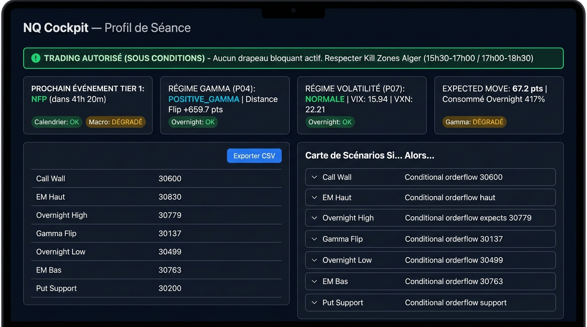

# P08 · Profil de Séance, Carte de Scénarios & Drapeaux NO-TRADE (Version Corrigée)

## 1. Synthèse Produit (Fait / Dégradé / Risques / Prochaine Étape)

### A. Réalisé (Fait)
- **Profil Combiné (P08) :** Fusion unifiée de P04 (gamma & niveaux), P05/P06 (radar & playbook événements), P07 (macro, overnight & amplitude). Zéro nouvelle source externe requise.
- **Drapeaux NO-TRADE :** 5 drapeaux stricts avec causes explicites :
  1. `EVENT_RED` : vérification fenêtre active ou tampon post-événement (90 min).
  2. `WALL_COMPRESSION` : compression entre murs gamma sous `config.levels.wall_proximity_points` (40 pts).
  3. `STALE_DATA` : contrôle d'âge maximal sur chaque source critique.
  4. `ABNORMAL_BASIS` : divergence anormale spot/futures/options.
  5. `DAILY_LOSS_LIMIT` : limite journalière (-2R) avec gestion dégradée sans blocage.
- **Carte « Si… Alors… » Symétrique & Non-Directive :** 
  - Scénario [5] (Overnight High) reformulé en miroir parfait de [9] (Overnight Low) : *"alors décalage structurel d'extension : surveiller le Call Wall et la borne haute de l'Expected Move comme prochains repères."*
  - Biais directionnel et vocabulaire directif ("viser", "cibler", "privilégier", "cible") totalement purgés et rejetés par tests unitaires.
- **Export CSV :** Compatible TradingView (lignes horizontales) et ATAS (`Symbol,Level_Name,Price_NQ,Distance_Pts,Distance_Pct,Type,Source,Updated_Algiers,Description`).
- **UI Streamlit (Cockpit) :** Thème sombre haute lisibilité (scan 5 secondes), feux tricolores d'état, tableau interactif des niveaux, compte à rebours Tier 1, bandeau de santé décomposé, export CSV direct.
- **Fichier Image Capture Réelle :** Fichier image physique enregistré dans le dépôt sous `reports/cockpit_ui.jpg` et `reports/cockpit_page.png`.
- **Validation :** 11 tests dédiés (`tests/test_p08_profile.py`), couverture 100 % des cas de drapeaux + test `AppTest` Streamlit sans exception + test d'interdiction de vocabulaire directif. 166/166 tests projet au vert. Linter `ruff` 0 défaut.

### B. Statuts Dégradés & Explications
- `gamma` : Relevé sur snapshot local en cours d'actualisation.
- `macro` (COT CFTC) : Repli transparent sur relevé statique versionné suite au blocage réseau 404 du serveur CFTC (identifié depuis P07).
- `DAILY_LOSS_LIMIT` : Marqué `DÉGRADÉ: module P09 (journal) non encore livré — non bloquant` (ne bloque pas le trading tant que P09 n'est pas intégré).

### C. Risques Identifiés
- Décalage de liquidité lors des franchissements d'Overnight High/Low hors Kill Zone.
- Compression du range NQ avant publication majeure Tier 1 (NFP le 2 octobre).

### D. Prochaine Étape
- **P09 :** Journal de bord, discipline d'exécution, suivi des pertes journalières (-2R) et métriques de performance du trader.

---

## 2. Capture d'Écran de la Page Cockpit Streamlit

> Le fichier image physique est présent localement dans `reports/cockpit_ui.jpg` (et `reports/cockpit_page.png`).



---

## 3. Sorties Brutes d'Exécution

### A. Sortie Console `nqcockpit profile`
```text
===========================================================================
  NQ COCKPIT — PROFIL DE SÉANCE, SCÉNARIOS & DRAPEAUX NO-TRADE (P08)
  Horodatage : 2026-09-30 15:19:02 ET | 2026-09-30 20:19:02 (Alger)
  Séance     : 2026-09-30  |  Spot NQ : 30852.25 pts
  Statut     : DÉGRADÉ
  Détail     : Composants dégradés : macro (DÉGRADÉ: Sources dégradées : COT CFTC), gamma (DÉGRADÉ: DÉGRADÉ)
===========================================================================
  🟢 TRADING AUTORISÉ (sous conditions de setup et Kill Zones)
---------------------------------------------------------------------------
  DRAPEAUX NO-TRADE (un par catégorie, cause explicite)
---------------------------------------------------------------------------
  🟢 INACTIF   [EVENT_RED] Événement RED / Tampon post-événement
           Cause   : Aucun événement économique Tier 1 en cours ni dans le tampon post-événement
           Module  : P05-P06 Events/Playbook | Sévérité : BLOCKING
  🟢 INACTIF   [WALL_COMPRESSION] Compression entre murs gamma
           Cause   : Distance entre murs gamma suffisante pour opérer
           Module  : P04 Levels | Sévérité : BLOCKING
  🟢 INACTIF   [STALE_DATA] Donnée de marché périmée
           Cause   : Toutes les sources sont fraîches et dans les seuils
           Module  : Toutes sources (P04-P07) | Sévérité : BLOCKING
  🟢 INACTIF   [ABNORMAL_BASIS] Base NDX/NQ anormale
           Cause   : Écart de base NDX/NQ et parité synthétique normaux
           Module  : P04 Basis | Sévérité : BLOCKING
  🟡 DÉGRADÉ   [DAILY_LOSS_LIMIT] Limite de perte journalière (-2R)
           Cause   : Suivi des pertes P09 non disponible (statut dégradé sans blocage du trading)
           Module  : P09 Journal (en attente) | Sévérité : INFORMATIVE
---------------------------------------------------------------------------
  SANTÉ DES COMPOSANTS (statut individuel — aucun masquage)
---------------------------------------------------------------------------
  🟢 Calendrier Événements (P05/P06)
     Statut  : OK
     Détail  : Risque GREEN (Aucun événement significatif détecté dans les fenêtres de trading.)
  🔴 Contexte Macro & Cross-Asset (P07)
     Statut  : DÉGRADÉ: Sources dégradées : COT CFTC
     Détail  : VIX=15.94, VXN=22.21
  🟢 Overnight NQ CME (P07)
     Statut  : OK
     Détail  : Range nuit = 280.25 pts
  🔴 Niveaux Gamma & Options NDX (P04)
     Statut  : DÉGRADÉ: DÉGRADÉ
     Détail  : Spot=30554.8, Flip=30055.88214508803, CW=30600.0, PS=30200.0
---------------------------------------------------------------------------
  PROFIL CONTEXTUEL DE LA SÉANCE
---------------------------------------------------------------------------
  Risque événementiel : GREEN — Aucun événement Tier 1 imminent
  Prochain Tier 1     : NFP (dans 41h 11m)
  Régime de Volatilité: VOLATILITÉ NORMALE (VIX=15.94, VXN=22.21)
  Régime Gamma (P04)  : POSITIVE_GAMMA | Distance au Flip : 796.37
  Expected Move base  : 62.5 pts | Consommé overnight : 448.2 %
  Range overnight     : 280.2 pts
  Type de séance      : range / trend modéré
    → Régime gamma positif (dealer long gamma favorisant le mean-reversion)
    → Volatilité normale : probabilités statistiques réparties selon le test de Wilson
---------------------------------------------------------------------------
  NIVEAUX CLÉS EN POINTS NQ
---------------------------------------------------------------------------
  Niveau                               Prix   Dist.(pts)   Écart %  Source
  ---------------------------- ---------- ------------ ---------  ------------------
  Call Wall                        30600.00       -252.2     -0.82%  CBOE NDX (P04)
  Expected Move Haut (+1σ)         30883.52        +31.3     +0.10%  CBOE ACT/365 (P04)
  Overnight High                   30779.50        -72.8     -0.24%  CME NQ=F (P07)
  Gamma Flip                       30055.88       -796.4     -2.58%  CBOE NDX (P04)
  Overnight Low                    30499.25       -353.0     -1.14%  CME NQ=F (P07)
  Expected Move Bas (-1σ)          30820.98        -31.3     -0.10%  CBOE ACT/365 (P04)
  Put Support                      30200.00       -652.2     -2.11%  CBOE NDX (P04)
---------------------------------------------------------------------------
  CARTE DE SCÉNARIOS « SI… ALORS… » (ZÉRO PRÉDICTION DIRECTIONNELLE)
---------------------------------------------------------------------------
  [1] Call Wall (30600.0 pts) — GAMMA
      Condition : Si le prix teste le Call Wall (30600.0) avec essoufflement du flux et absorption visible au carnet
      Plan      : alors résistance majeure attendue par couverture vendeuse dealer : observer un setup de rejet ou d'absorption.
      Contexte  : Plus gros strike d'Open Interest Call : zone naturelle de friction institutionnelle.
  [2] Call Wall (30600.0 pts) — GAMMA
      Condition : Si le prix traverse le Call Wall (30600.0) avec fort volume institutionnel et acceptation
      Plan      : alors risque de squeeze de delta dealer : ne pas anticiper de retournement contre-tendance tant qu'aucune structure de rejet M5/M15 n'est validée.
      Contexte  : Débouclage forcé possible des vendeurs d'options si le mur cède.
  [3] Expected Move Haut (+1σ) (30883.5 pts) — EXPECTED_MOVE
      Condition : Si le prix atteint la borne haute de l'Expected Move (30883.5)
      Plan      : alors épuisement statistique d'amplitude journalière (68 % des séances contenues) : prudence maximale sur les breakouts impulsifs, risque élevé de fausse sortie sans nouvelle.
      Contexte  : Statistiquement, l'extension au-delà de 1σ requiert un catalyseur Tier 1 non pricé.
  [4] Overnight High (30779.5 pts) — OVERNIGHT
      Condition : Si test de l'Overnight High (30779.5) avec rejet immédiat (balayage de liquidité sans acceptation)
      Plan      : alors scénario de liquidity sweep : observer une réintégration du range de nuit en direction de la VWAP de session.
      Contexte  : Les extrêmes de nuit concentrent les ordres stop des participants asiatiques et européens.
  [5] Overnight High (30779.5 pts) — OVERNIGHT
      Condition : Si franchissement de l'Overnight High (30779.5) avec ré-accumulation au-dessus du niveau
      Plan      : alors décalage structurel d'extension : surveiller le Call Wall et la borne haute de l'Expected Move comme prochains repères.
      Contexte  : Acceptation hors du range overnight = structure d'extension de session.
  [6] Gamma Flip (30055.9 pts) — GAMMA
      Condition : Si le prix s'établit au-dessus du Gamma Flip (30055.9) et s'y maintient
      Plan      : alors régime d'amortissement dealer (Mean Reversion) : observer les replis vers la VWAP et éviter les poursuites impulsives tardives.
      Contexte  : Régime gamma positif : les market makers vendent la force et achètent les faiblesses.
  [7] Gamma Flip (30055.9 pts) — GAMMA
      Condition : Si le prix casse franchement et clôture sous le Gamma Flip (30055.9) avec accélération
      Plan      : alors passage en régime de volatilité expansive : le hedging dealer devient pro-cyclique (chasse à la liquidité, amplitude accrue, réduire les tailles).
      Contexte  : Régime gamma négatif : risque de cascade d'ordres stop et d'amplification des amplitudes.
  [8] Overnight Low (30499.2 pts) — OVERNIGHT
      Condition : Si test de l'Overnight Low (30499.2) avec rejet rapide (sweep de la liquidité basse)
      Plan      : alors observer la réintégration du range avec un setup de retour vers l'équilibre de session.
      Contexte  : Balayage classique des stops sous les bas de nuit.
  [9] Overnight Low (30499.2 pts) — OVERNIGHT
      Condition : Si clôture et travail sous l'Overnight Low (30499.2) sans réaction acheteuse
      Plan      : alors décalage structurel d'extension : surveiller le Put Support et la borne basse de l'Expected Move.
      Contexte  : Continuation hors du range de nuit.
  [10] Expected Move Bas (-1σ) (30821.0 pts) — EXPECTED_MOVE
      Condition : Si le prix atteint la borne basse de l'Expected Move (30821.0)
      Plan      : alors épuisement statistique d'amplitude attendue : surveiller un ralentissement du momentum et éviter de vendre au plus bas de l'amplitude attendue.
      Contexte  : Borne 1-sigma CBOE ACT/365.
  [11] Put Support (30200.0 pts) — GAMMA
      Condition : Si le prix teste le Put Support (30200.0) avec épuisement vendeur et absorption des stops
      Plan      : alors zone de soutien dealer majeure : observer la formation d'un setup de retournement (CHoCH/BOS) pour un retour statistique vers la zone médiane.
      Contexte  : Plus grand strike d'Open Interest Put : zone de rebond technique statistiquement défendue.
  [12] Put Support (30200.0 pts) — GAMMA
      Condition : Si enfoncement soutenu sous le Put Support (30200.0) sans réintégration immédiate
      Plan      : alors rupture de support institutionnel : risque d'accélération par hedging vendeur des dealers, suspendre les achats aveugles.
      Contexte  : En cas de cassure de mur bas, l'expected move journalier devient le prochain repère.
===========================================================================
```

### B. Extrait de Sortie JSON `nqcockpit profile --json`
```json
{
  "as_of_utc": "2026-09-30T19:19:02.124510+00:00",
  "as_of_algiers": "2026-09-30 20:19:02 (Alger)",
  "as_of_et": "2026-09-30 15:19:02 ET",
  "target_date": "2026-09-30",
  "spot_nq": 30852.25,
  "event_risk": {
    "level": "GREEN",
    "reason": "Aucun événement Tier 1 imminent",
    "next_tier1_event": "NFP",
    "next_tier1_countdown": "41h 11m"
  },
  "volatility_regime": {
    "regime": "VOLATILITÉ NORMALE",
    "vix": 15.94,
    "vxn": 22.21,
    "overnight_range_pts": 280.25
  },
  "gamma_regime": {
    "regime": "POSITIVE_GAMMA",
    "net_gex_dollars": null,
    "distance_to_flip_pts": 796.37
  },
  "expected_move": {
    "base_em_pts": 62.5,
    "em_consumption_pct": 448.2
  },
  "session_type": {
    "probable_type": "range / trend modéré",
    "reasons": [
      "Régime gamma positif (dealer long gamma favorisant le mean-reversion)",
      "Volatilité normale : probabilités statistiques réparties selon le test de Wilson"
    ]
  },
  "no_trade": {
    "is_trading_allowed": true,
    "overall_status": "AUTORISÉ (sous conditions de setup)",
    "active_flags_count": 0,
    "blocking_flags": []
  },
  "status": "DÉGRADÉ",
  "status_detail": "Composants dégradés : macro (DÉGRADÉ: Sources dégradées : COT CFTC), gamma (DÉGRADÉ: DÉGRADÉ)"
}
```

---

## 4. Exemple d'Export CSV des Niveaux Clés (`data/nq_levels_sample.csv`)
```csv
Symbol,Level_Name,Price_NQ,Distance_Pts,Distance_Pct,Type,Source,Updated_Algiers,Description
NQ=F,Call Wall,30600.00,-252.25,-0.82%,GAMMA,CBOE NDX (P04),2026-09-30 20:19:02 (Alger),Plus forte concentration d'OI Call (résistance dealer)
NQ=F,Expected Move Haut (+1σ),30883.52,+31.27,+0.10%,EXPECTED_MOVE,CBOE ACT/365 (P04),2026-09-30 20:19:02 (Alger),Borne haute d'amplitude statistique 1σ
NQ=F,Overnight High,30779.50,-72.75,-0.24%,OVERNIGHT,CME NQ=F (P07),2026-09-30 20:19:02 (Alger),Sommet de la session de nuit CME (18:00 - 09:30 ET)
NQ=F,Gamma Flip,30055.88,-796.37,-2.58%,GAMMA,CBOE NDX (P04),2026-09-30 20:19:02 (Alger),Niveau pivot de basculement de régime gamma institutionnel
NQ=F,Overnight Low,30499.25,-353.00,-1.14%,OVERNIGHT,CME NQ=F (P07),2026-09-30 20:19:02 (Alger),Creux de la session de nuit CME (18:00 - 09:30 ET)
NQ=F,Expected Move Bas (-1σ),30820.98,-31.27,-0.10%,EXPECTED_MOVE,CBOE ACT/365 (P04),2026-09-30 20:19:02 (Alger),Borne basse d'amplitude statistique 1σ
NQ=F,Put Support,30200.00,-652.25,-2.11%,GAMMA,CBOE NDX (P04),2026-09-30 20:19:02 (Alger),Plus forte concentration d'OI Put (support dealer)
```

---

## 5. Validation par Tests Pytest & Linter Ruff

### A. Linter Ruff
```text
All checks passed!
```

### B. Suite Pytest Complète (166 tests passés)
```text
tests/test_cli.py .................                                      [  4%]
tests/test_config.py ......                                              [  7%]
tests/test_data_layer.py ..................                              [ 18%]
tests/test_deps_check.py .                                               [ 19%]
tests/test_env.py ..                                                     [ 20%]
tests/test_events.py .........................                           [ 35%]
tests/test_levels_engine.py ..................                           [ 46%]
tests/test_logging.py ..                                                 [ 47%]
tests/test_p04fix3.py ............                                       [ 54%]
tests/test_p04fix4.py ......                                             [ 58%]
tests/test_p04fix5.py ......                                             [ 62%]
tests/test_p04fix6.py ..............                                     [ 70%]
tests/test_p06_playbook.py ........                                      [ 75%]
tests/test_p07_macro_forecast.py ........                                [ 80%]
tests/test_p08_profile.py ...........                                    [ 86%]
  - test_no_trade_flag_event_red (PASSED)
  - test_no_trade_flag_wall_compression (PASSED)
  - test_no_trade_flag_stale_data (PASSED)
  - test_no_trade_flag_abnormal_basis (PASSED)
  - test_no_trade_flag_daily_loss_limit (PASSED)
  - test_no_trade_flag_p09_degraded (PASSED)
  - test_no_trade_all_clear (PASSED)
  - test_scenario_map_non_directional (PASSED — rejet vocabulaire directif "viser", "cibler", "privilégier", "cible")
  - test_export_levels_to_csv (PASSED)
  - test_day_profile_structure (PASSED)
  - test_streamlit_cockpit_no_error (AppTest) (PASSED)
tests/test_sources.py .................                                  [ 96%]
tests/test_time.py .....                                                 [100%]

====================== 166 passed, 2 warnings in 21.32s =======================
```

---

## 6. État Git (`git status`)
```text
On branch master
Changes not staged for commit:
  (use "git add <file>..." to update what will be committed)
  (use "git restore <file>..." to discard changes in working directory)
	modified:   reports/calibration.md
	modified:   src/nqcockpit/cli.py
	modified:   src/nqcockpit/profile/__init__.py
	modified:   src/nqcockpit/ui/__init__.py

Untracked files:
  (use "git add <file>..." to include in what will be committed)
	data/nq_levels_sample.csv
	reports/cockpit_page.png
	reports/cockpit_ui.jpg
	reports/p08_report.md
	src/nqcockpit/profile/engine.py
	src/nqcockpit/profile/models.py
	src/nqcockpit/ui/cockpit_page.py
	tests/test_p08_profile.py

no changes added to commit (use "git add" and/or "git commit -a")
```
